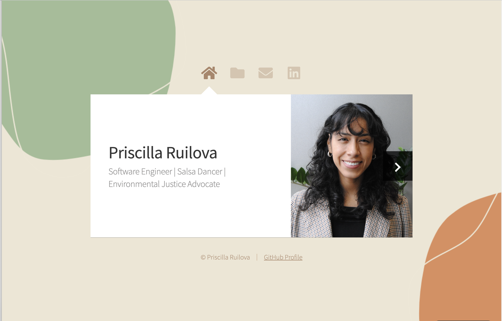

# Welcome to my website! 

## This lovely design was created by AJ (aj@lkn.io | @ajlkn) from HTML5 UP for personal use and I had a lot of fun personalizing it to meet my needs and design preferences. 

### Features
- This site shows some of my past work, includes a contact form for those interested in reaching out, and links to my LnkedIn account to learn more about me and to give you a chance to contact me through there as well. 
- My website is hosted on Netlify but also here on GitHub pages 

### How to access site: 
- Click on the link in the "About" section to the right of this repo. 

### Message for you: 
As a software engineer my focus is on using tech for good, relentless in my pursuit of knowledge and following through on complex projects. I am excited to build alongside people who believe that technology can be a tool for strengthening communities, expanding access, and creating lasting change.

